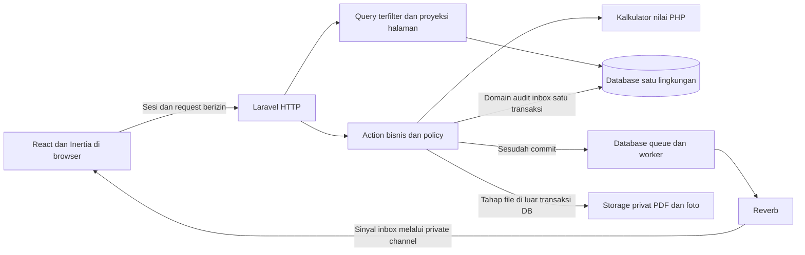

# Arsitektur aplikasi - SIA MI Alghivari

Diperbarui: 29 Oktober 2026. Pemilik desain: pemilik proyek. Status: **PROPOSED / blueprint**, implementasi aplikasi inti/server **NOT STARTED**, pengujian backend **NOT RUN**. Prototipe frontend tinjauan tersedia terpisah di docs/support/facelift-v2. Keputusan ARC-001 dan telaah penyusun ada pada [ARCHITECTURE_REVIEW.md](ARCHITECTURE_REVIEW.md); bentuk satu aplikasi Laravel + Inertia + React/TypeScript dikonfirmasi 29 Oktober 2026; detail desain lain belum disetujui menyeluruh dan belum ada review implementasi independen.

## 1. Lingkup dan sumber keputusan

Sistem akademik satu sekolah: persiapan periode/penugasan, absensi per mapel, penilaian, perkembangan wali, rapor semester dan approval naik/lulus. Tidak mengimpor aplikasi lama. [PRD](PRD.md), [brief](PROJECT_BRIEF.md), [matriks izin](ROLE_PERMISSION_MATRIX.md), [akses sumber daya](RESOURCE_ACCESS_POLICY.md) dan [alur akademik](ACADEMIC_FLOW.md) menjadi sumber perilaku produk.

Bentuk aplikasi yang dikonfirmasi pemilik 29 Oktober 2026: satu aplikasi Laravel + Inertia + React/TypeScript. Satu database relasional dan storage privat tetap menjadi rancangan; engine MySQL dipilih pemilik 29 Oktober 2026, baseline versi inti disepakati pada TECH_STACK, sedangkan konfigurasi, paket tambahan dan versi persis mengikuti status [TECH_STACK.md](TECH_STACK.md). Reverb/Echo serta Compose/CD juga dikonfirmasi sebagai blueprint. Struktur berikut belum ada di filesystem aplikasi.

Tidak ada kebutuhan API publik/mobile terpisah, SSR, offline write, banyak sekolah, chat atau workflow builder. Kapasitas, concurrency dan p95 belum diukur; retensi data domain belum diputuskan. Alur backup lokal lalu unggah manual Google Drive (D-30) serta jadwal/retensi backup (D-31) telah dipilih, tetapi restore fungsional belum diuji. Target formal RPO/RTO berada di luar lingkup portofolio (D-32), bukan keputusan terbuka. Hindari klaim arsitektur scalable atau production-ready tanpa bukti.

[Facelift-v2](support/facelift-v2/README.md) adalah **referensi desain, bukan panduan implementasi wajib**. Pola konteks, input satu aktivitas, state dan adaptasi ponsel dapat dipertimbangkan setelah cocok dengan PRD/API/izin. Jangan menyalin fixture, pemilih skenario QA, state memori, asumsi rentang/presisi atau scaffold Vite sebagai arsitektur aplikasi inti. Referensi tersebut tidak mengubah batas Laravel/Inertia, hak pengguna, transaksi atau keputusan Q6/visual Q7/lifecycle.

## 2. Bentuk sistem dan batas proses



HTTP, worker dan Reverb adalah proses berbeda yang menggunakan versi kode aplikasi sama, bukan layanan bisnis independen. Cloudflare Tunnel adalah jalur jaringan ke HTTP/Reverb, bukan tempat data/otorisasi. GHCR/runner deployment bukan bagian dari request akademik. Detail topologi: [DEPLOYMENT_ARCHITECTURE.md](DEPLOYMENT_ARCHITECTURE.md).

## 3. Batas fitur dan kepemilikan data

Nama modul berarti kelompok tanggung jawab dalam satu codebase, bukan paket/plugin atau database terpisah. Pengembang yang mengubah fitur bertanggung jawab atas action, policy, query, UI dan tesnya; pemilik proyek menetapkan aturan yang belum final.

| Kelompok fitur | Memiliki aturan/tulisan utama | Batas kontrak |
| --- | --- | --- |
| Identitas/profil | Akun, role tetap, aktivasi dan profil allowlist | Role/jabatan hanya Master; perubahan profil tidak mengubah akses. Urutan akun wali Q6.1 dan lifecycle password D-25 telah dipilih; allowlist, parameter/provider, bootstrap dan fallback masih terbuka. |
| Akademik | Periode, rombel, enrollment, mapel, penugasan, jadwal, komponen dan policy global | Wali kelas melalui homeroom_assignments; guru tidak mengubah KKM/bobot. Delegasi/request sesuai keputusan final. |
| Kehadiran | Sesi mapel, daftar status, pengesahan | Sesi finalized menjadi sumber rekap; blank bukan alpa. |
| Penilaian | Assessment, skor, publikasi hasil kegiatan | Katalog pusat; blank berbeda dari 0; bobot dari policy, bukan assessment. |
| Rapor | Kelengkapan, snapshot, revisi, render dan publikasi | Membaca sumber sah melalui kontrak rekap, tidak mengedit nilai guru atau membaca ulang live data untuk rapor lama. |
| Kenaikan/kelulusan | Proposal, approval, needs_review dan apply | Principal approve, penerapan terpisah; enrollment historis dipertahankan. Pelaksana final mengikuti Q6. |
| Aktivitas sistem | Audit, pemilihan penerima, inbox/read-state dan broadcast | Dipanggil action dalam transaksi; tidak mengambil alih aturan akademik. Pembaca selalu terfilter. |
| Portal/halaman baca | Direktori, perkembangan, ringkasan kelas dan principal | Query/proyeksi berizin, tanpa tabel perkembangan duplikat atau jalur tulis tersembunyi. |

Lintas fitur boleh membaca relasi/proyeksi yang diperlukan. Perubahan pada data fitur lain harus melalui operasi bisnis pemiliknya; jangan mengubah score dari fitur rapor atau role dari form profil. Workflow lintas fitur memiliki satu action koordinator dan satu transaksi luar, bukan rangkaian action yang masing-masing commit sendiri.

## 4. Struktur kode yang diusulkan

Prinsip **Ponytail full**: pilih perubahan paling kecil yang menyelesaikan use case dan seluruh konsumen yang terkena. Struktur di bawah adalah tempat tanggung jawab yang diperlukan, bukan kewajiban membuat file/lapisan untuk setiap model atau endpoint. CRUD sederhana dapat memakai controller/request/policy framework; action dipakai ketika transaksi, state atau aturan bersama memang memerlukannya. Reuse komponen/helper yang layak sebelum membuat abstraksi; hindari repository generik, service serba guna dan wrapper satu pemanggil tanpa manfaat.

Saat memperbaiki aturan, telusuri pemanggil dan perbaiki sumber bersama sekali; ikutkan query, UI, job, fixture, tes dan konfigurasi yang terdampak. Tetap pertahankan kontrak tipe/presisi, policy, audit/inbox atomik, snapshot serta error/retry yang aman. Ringkas berarti tanggung jawab jelas dan diff kecil, bukan source satu baris padat atau pengurangan bukti keamanan. Rincian penggunaan Ponytail, antislop dan taste-skill ada pada [CODE_QUALITY_PLAN](CODE_QUALITY_PLAN.md).

Gunakan direktori Laravel biasa dengan pengelompokan fitur seperlunya. Bukan kewajiban membuat semua direktori/class pada hari pertama:

```text
app/
  Http/Controllers/        HTTP dan pemilihan respons
  Http/Requests/           Validasi bentuk, allowlist dan otorisasi awal
  Models/                 Relasi, cast dan query dasar Eloquent
  Policies/               Hak action/resource/field
  Actions/                Use case tulis, dikelompokkan menurut fitur
  Queries/                Query baca kompleks yang digunakan ulang
  Services/Grading/       Kalkulasi murni dan pemeriksaan kelengkapan
  Services/Reports/       Snapshot dan renderer PDF yang diperlukan
  Services/Audit/         Pencatatan internal tanpa endpoint tulis
  Services/Notifications/ Pemilihan penerima dan inbox
  Jobs/                   Efek asinkron yang memang diperlukan
resources/js/
  pages/                  Halaman fitur
  components/             Kontrol bersama yang benar-benar digunakan
  layouts/                Shell, navigasi dan konteks periode
  hooks/                  Perilaku UI/Echo yang digunakan ulang
  types/                  Kontrak props/form
resources/views/reports/ Template cetak PDF
routes/                   HTTP dan otorisasi channel
```

Penamaan final mengikuti rilis starter kit; tree ini bukan hasil scaffolding. Eloquent boleh dipakai langsung oleh action/query. Tidak ada repository/interface per tabel, event bus, command bus atau empat lapis DDD wajib. Query sederhana boleh tetap di controller; seluruh tulisan domain tetap melewati operasi yang menjamin policy/audit/transaksi.

Controller tidak memegang rumus/transaksi panjang. Action tidak bergantung pada Request/Inertia/komponen React; masukan berupa aktor, ID dan data tervalidasi, keluaran berupa hasil terstruktur. Kalkulator menerima nilai numerik/blank, hitungan hadir dan policy yang sudah dipilih; tidak memanggil HTTP, DB, filesystem atau Reverb. Service audit/inbox bergabung dengan transaksi pemanggil, tidak membuka commit sendiri. Model observer saja tidak cukup untuk audit bulk.

## 5. Alur data dan kontrak

### Membaca halaman

Sesi/akun aktif -> policy/query scope -> filter sebelum pagination/count -> proyeksi field -> props Inertia. Menu/capability UI adalah petunjuk interaksi, bukan sumber izin. Shared props hanya identitas minimum, konteks dan kemampuan yang diperlukan; jangan menyertakan semua model/relasi pada setiap halaman.

Perkembangan Belajar mengambil assessment published serta sesi finalized anak yang berhak, meski rapor belum ada. Rapor Online hanya membuka snapshot published/current aktif anak terkait; needs_revision/revoked/superseded tidak dapat dibaca atau diunduh wali (D-28). Nilai kosong dapat diproyeksikan sebagai null dan status belum tersedia pada respons tanpa membuat baris skor di DB. Nilai 0 tetap angka sah. Desimal untuk kalkulasi dipertahankan sebagai representasi presisi; JavaScript bukan sumber nilai final. Kontrak ID harus konsisten dan tidak kehilangan presisi BIGINT.

### Menulis satu operasi

Form -> validasi input/allowlist -> action -> transaksi/lock -> baca ulang hak, penugasan/delegasi, state dan version -> validasi seluruh batch -> tulis domain + audit per objek + inbox terkelompok -> commit -> dispatch efek sesudah commit -> respons sukses. Semua jalur tulis, termasuk job/command admin kelak, mengikuti aturan yang sama. Tidak ada endpoint menerima daftar penerima, role atau path file bebas sebagai bukti izin.

Mutex akademik, token version, unique/FK dan retry mengikuti usulan [DATABASE_ARCHITECTURE.md](DATABASE_ARCHITECTURE.md) dan [provider](DATABASE_PROVIDER_IMPLEMENTATION.md). Kunci operasi batch terikat pengguna/scope/payload sesuai action; menonaktifkan tombol bukan dedup server. Kegagalan salah satu baris membatalkan batch, bukan sukses sebagian tersembunyi.

### Rapor dan file

Preview menunjukkan policy/calculation version dan ketersediaan sumber. Finalisasi memeriksa kembali sumber/versi dan membekukan seluruh item dalam transaksi. Semua komponen berbobot positif harus memiliki data; blank sebagian tetap dilewati. D-26/D-27 telah menetapkan konsolidasi pada class_subject stabil: seluruh nilai published dihitung per komponen tanpa rata-rata per guru, dan kehadiran memakai frozen record finalized per siswa. Satu item rapor per mapel; source assignment/creator tetap provenance, bukan grant guru lama.

Renderer yang disepakati pemilik 29 Oktober 2026 adalah Dompdf melalui barryvdh/laravel-dompdf 3.1.x (D-17), dengan template Blade khusus cetak; susunan ringkas Q7.1 serta aturan numerik Q7.2-Q7.5 telah diterima. Detail visual dan hasil implementasi/render belum diverifikasi. Catatan wali kelas opsional tingkat rapor hanya dapat diubah pada draft binaan oleh wali kelas aktif atau Master; dibekukan bersama snapshot final, tanpa mengedit skor mapel lain. Render PDF dari snapshot finalized/current di luar lock, selesaikan file lalu tautkan setelah memeriksa ulang version/availability/source. Publish memeriksa kesiapan snapshot/file dan hak kelas terkini; revisi memakai policy/calculation asli dan supersede versi terbit sebelumnya secara atomik (D-28). Download wali memeriksa hubungan anak serta published/current aktif lagi; staf tetap mengikuti scope isi rapor yang diizinkan. Path klien tidak diterima. File gagal tidak membuka versi held/revoked/superseded atau memberi status published palsu. DB/filesystem bukan satu transaksi ACID. Foto profil juga memakai tahapan tulis file/tautkan/bersihkan lama yang aman.

### Notifikasi dan job

Inbox disimpan bersama domain/audit; broadcast setelah commit melalui worker -> Reverb -> Echo. Event hanya sinyal minimal, klien mengambil ulang inbox/count berizin dan dedup ID. Reconnect/refresh memulihkan dari DB. Dispatch dapat gagal sebelum enqueue; sinyal realtime bukan exactly-once. Tidak menambah outbox karena inbox persisten memenuhi kebutuhan inti saat ini.

Job yang melakukan operasi bisnis harus memeriksa aktor/scope/state lagi; payload job memakai ID/versi minimum, bukan salinan profil atau hak lama. Core input/finalisasi tidak dijadikan job hanya untuk terlihat asinkron. Pembuatan PDF massal baru diantrekan jika kebutuhan/pengukuran membenarkannya. [NOTIFICATION_REQUIREMENTS.md](NOTIFICATION_REQUIREMENTS.md).

## 6. Identitas, keamanan dan kontrak kegagalan

Login sesi Laravel/Fortify, akun dikelola tanpa registrasi publik; lifecycle sesi, CSRF, pembatasan login dan perubahan password memakai fasilitas framework yang diverifikasi saat implementasi. D-25 telah memilih email untuk password sementara serta OTP reset/profil, dengan modal pilihan sesi setelah password tersimpan. Parameter, provider pengiriman, bootstrap dan fallback masih terbuka; pilihan kanal tidak membuktikan email sudah dikonfigurasi atau terkirim. Policy objek/field berlaku pada HTTP, download, worker dan channel.

Jangan memakai bypass Master global yang melewati audit, transisi rapor atau approval principal. Principal read dengan pengecualian approve; hak mengajar berasal dari penugasan terpisah. Hak publikasi wali kelas dibatasi binaan. Data Entry tidak memberi diri sendiri role/penugasan/delegasi. Audit dibuat internal; tidak ada route CUD audit dan SQL runtime tidak memiliki UPDATE/DELETE audit atau DDL.

Query terparameterisasi, allowlist sort/filter, ukuran batch/upload dibatasi, konten foto diverifikasi, dan proyeksi output tidak membawa hash/token/draft terlarang. Secret hanya server; WSS/private channel tidak menjadikan payload otomatis aman. Bersihkan state sensitif saat logout/pergantian anak dan jangan menyimpan nilai/profil ke localStorage sebagai default.

| Keadaan | Perilaku yang direncanakan |
| --- | --- |
| Input invalid | Error per field/baris; data belum disimpan. Form Inertia memakai alur validasi framework, bukan dipaksa menjadi API JSON umum. |
| Tidak berhak/tidak ditemukan | 403 atau 404 menurut kebijakan eksposur; pesan tidak membocorkan identitas objek lain. |
| Versi usang/transisi tidak sah | Konflik eksplisit dan tinjau ulang, pertahankan isian aman; jangan menimpa atau retry buta. |
| Hasil request tidak pasti karena jaringan | Verifikasi keadaan/kunci operasi sebelum mengulang; jangan mengklaim transaksi pasti batal. |
| DB/audit/inbox gagal | Tidak sukses domain; rollback jika belum commit, tampilkan error aman dan correlation ID. |
| Realtime mati | Data yang commit tetap sah; indikator koneksi dan catch-up inbox, bukan rollback bisnis atau daftar kosong palsu. |
| File gagal | Jangan publikasikan keberhasilan download; retry dari snapshot yang sama dengan izin terkini. |

Status HTTP untuk konflik dan format respons rinci ditetapkan pada kontrak endpoint saat implementasi; tidak memakai status internal Inertia untuk arti bisnis lain. Respons mutasi hanya sukses setelah commit. API pendukung kecil untuk inbox/count/channel/file tetap dalam aplikasi/sesi yang sama.

Rancangan endpoint dan shape kini dirinci pada [API_CONTRACT.md](API_CONTRACT.md): form Inertia memakai redirect/error props, JSON pendukung memiliki negosiasi/status tersendiri, dan PDF lewat GET browser berizin. Konflik versi bisnis tidak memakai 409 protokol Inertia. Omitted/null/0 pada input dibedakan; clear skor/absensi existing adalah DELETE domain dan ditolak untuk Data Entry. Detail tersebut masih proposal kontrak, belum route atau policy terpasang.

## 7. UI, operasi dan evolusi

Navigasi menurut tugas, konteks periode/kelas terlihat dan pergantian konteks tidak memperluas hak. Ikuti [USER_FLOWS.md](USER_FLOWS.md): halaman nilai/absensi desktop terfokus dan versi ponsel yang dapat digunakan, loading/kosong/error/konflik, label/fokus keyboard serta informasi selain warna. Draft form lokal React cukup; belum membutuhkan Redux, offline queue atau sinkronisasi realtime nilai.

Operasi demo mengikuti [CI/CD](CICD_PIPELINE_SPEC.md), [environment](ENVIRONMENT_SPEC.md), [deployment](DEPLOYMENT_PLAN.md) dan [migrasi/pemulihan](DATABASE_MIGRATION_PLAN.md). App/queue/Reverb memakai digest sama, dev/demo terpisah, file/DB persisten, bukan zero downtime satu host.

Log teknis terpisah dari audit pengguna: correlation/operation ID, nama operasi, hasil, durasi dan kode kegagalan minimum tanpa body request/nilai/password/token. Pantau error HTTP, job gagal/tertunda, Reverb, koneksi/lock DB dan disk/backup dengan alat minimum yang benar-benar diperlukan. Belum ada layanan telemetry eksternal, kanal alert, SLO atau angka performa yang disepakati.

Batas modul ditinjau melalui tes kalkulator, policy/HTTP, transaksi/konkurensi MySQL, alur browser, file dan kegagalan worker/reconnect. Rincian penerimaan/review: [ARCHITECTURE_REVIEW.md](ARCHITECTURE_REVIEW.md) dan [DATABASE_VERIFICATION_REPORT.md](DATABASE_VERIFICATION_REPORT.md). Semua NOT RUN. Pemisahan service, cache, outbox, SSR atau multi-tenant hanya dikaji ulang saat kebutuhan/bukti mengharuskannya.

Standar kode dan pemeriksaan sesuai tahap perubahan dirancang pada [CODE_QUALITY_PLAN.md](CODE_QUALITY_PLAN.md); alat kualitas tidak menggantikan review kontrak dan hasil perilaku.

Rancangan respons kegagalan dan pembuktiannya ada pada [BACKEND_FAILURE_MODE_PLAN](BACKEND_FAILURE_MODE_PLAN.md); alur inbox/queue/socket dirinci pada [NOTIFICATION_ARCHITECTURE](NOTIFICATION_ARCHITECTURE.md). Keduanya blueprint dengan expected outcome, bukan hasil uji backend.

Referensi primer diperiksa 28 Oktober 2026: [struktur Laravel](https://laravel.com/framework/docs/13.x/structure), [Policies](https://laravel.com/framework/docs/13.x/authorization), dan [Inertia](https://inertiajs.com/). Susunan action/query/service di atas adalah keputusan desain proyek yang diusulkan, bukan struktur wajib framework.

## Lifecycle credential D-25

[RECOVERY_AND_STEPUP_PLAN](RECOVERY_AND_STEPUP_PLAN.md), [DATA_MODEL](DATA_MODEL.md), [API AUTH-PW](API_CONTRACT.md) menjadi kontrak password. Fouladgar + Mail/Notifications/database queue, otp_tokens hash, database sessions dan metadata forced-change/credential version/session generation/pending. Controller/request/action/policy framework biasa; repository package diadaptasi untuk hash/atomic user->challenge lock, bukan subsistem auth/microservice baru. Password/proof/pending/audit DB atomik; SMTP/cookie sesudahnya bukan satu transaksi. Forced/proof/modal context hanya akses terbatas, tidak membuka domain/file/channel.

Pilihan No harus benar-benar mempertahankan sesi; middleware auth.session hash mismatch dan logoutOtherDevices tidak otomatis sesuai. Jangan menunda password sampai modal atau menyimpan plaintext baru untuk request modal. Konfigurasi vendor migration auto-load/prune, binding, parameter dan provider masih perlu implementasi/test. Tidak memasang Spatie/Livewire/Redis atau OTP login umum. Review sumber/blueprint tidak membuktikan runtime aman.

## Identitas akademik D26/D27

class_subjects menyimpan mapel kelas stabil, teaching_assignments histori bertanggal; jadwal/kegiatan/item rapor parent stabil dan provenance source tetap. Current effective G mengakses histori/draft melalui parent, bukan ID guru lama; published/final tetap dilindungi. Roster_version mengusangkan form, finalize memeriksa eligible set/status lengkap dan freeze attendance_records. Aggregator menghitung seluruh published skor per komponen dan record final per siswa, bukan average guru atau count seluruh kelas. Mutex/parent lock menjaga handover/membership/finalize/audit/inbox; runtime NOT RUN. [Alur](ACADEMIC_FLOW.md).

D-28 diterima: koreksi sumber adalah action terpisah dari draft CRUD; transaksi memuat audit/inbox dan penahanan rapor per siswa. Isi snapshot immutable, metadata lifecycle/version diaudit. Revisi memakai policy/calculation asli termasuk retired, satu versi published/current; render di luar lock dan attach/publish recheck. Jangan menambah workflow engine/tabel koreksi atau undo applied otomatis. [Lifecycle kanonis](ACADEMIC_FLOW.md), verifikasi API-T55..57/DBV29..30 **NOT RUN**.

D-29: school_timezone pada system_settings, satu value/version per request/job; shared Inertia id/label/version, formatter PHP/JS eksplisit, runtime/DB UTC. Tidak memakai .env/config-cache untuk setting dinamis atau global timezone mutable lintas job. Mutasi sensitif recheck timezone-version/grant/date dalam protokol lock; stale meminta refresh/review. Tidak menambah layanan, tabel timezone, setting tampilan kedua atau force refresh realtime. [Kontrak](API_CONTRACT.md).
