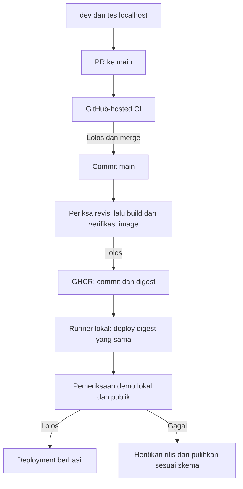

# Spesifikasi CI/CD - SIA MI Alghivari

Diperbarui: 28 Oktober 2026. Status: alur otomatis demo disepakati sebagai blueprint; workflow dan runner belum dibuat. Seluruh job **NOT RUN**. Acuan: [TECH_STACK.md](TECH_STACK.md), [environment](ENVIRONMENT_SPEC.md), [rencana deployment](DEPLOYMENT_PLAN.md).

## Branch dan artefak

Pengembangan berlangsung pada dev, lalu PR ke main. Main hanya menerima revisi yang lolos pemeriksaan wajib dan review pemilik. Proteksi branch/ruleset harus benar-benar dikonfigurasi sesuai visibilitas repository dan paket GitHub yang tersedia; tulisan dalam dokumen bukan enforcement.

Tidak menerbitkan image rilis atau menjalankan CD dari dev, fork/PR, job gagal atau revisi yang belum diperiksa. Image main dibangun sekali untuk rilis; artefak yang diperiksa itulah yang dijalankan demo. Label commit membantu penelusuran, digest mengunci konten. Deployment tidak mengikuti tag latest tanpa identitas versi.

## Tahap dan kontrak keberhasilan

| Tahap | Pelaksana | Pemeriksaan yang direncanakan |
| --- | --- | --- |
| Lokal | Pemilik pada dev | Tes terfokus, UI/alur terkait dan build sesuai perubahan; tidak menggantikan CI. |
| PR | GitHub-hosted runner | Install dari lockfile, formatter/static/type checks, tes MySQL, regresi izin/akademik/audit, build frontend serta pemeriksaan dependency/secret. Alur browser inti sesuai tahap aplikasi. |
| Main | GitHub-hosted runner | Periksa revisi hasil merge; build image runtime, uji startup/HTTP terhadap image dan dependency/image scan sesuai kebijakan. Tanpa secret demo. |
| Publikasi | Job main dengan packages write | Push ke GHCR, rekam digest, commit dan laporan pemeriksaan. Gate wajib gagal berarti tidak publish. |
| Deployment | Self-hosted runner khusus demo | Bergantung pada hasil verifikasi/publikasi; cocokkan commit/digest, preflight backup/skema, migrasi kompatibel dan pergantian terkendali app/queue/reverb. |
| Verifikasi | Job deployment | HTTP/DB, worker memproses job uji aman, WSS/private channel dan catch-up, serta smoke alur inti dengan akun/data sintetis. Rekam versi aktif dan hasil. |

Perintah, scanner, batas waktu dan bukti tes dikonfigurasi setelah aplikasi tersedia. Nama tahap tidak menjamin gate telah berjalan. Tidak menambah staging permanen sekarang; rehearsal lokal terisolasi diperlukan untuk perubahan migrasi/runtime sebelum demo diperbarui.

Kategori pemeriksaan dan syarat aktivasi command mengikuti [CODE_QUALITY_PLAN.md](CODE_QUALITY_PLAN.md), CQ-01..11. Gate memakai mode check, bukti revisi target dan hasil nyata; command kosong, check yang diperlukan tetapi terlewat, atau kegagalan kritis tidak boleh dianggap PASS. Daftar tersebut belum merupakan konfigurasi workflow.

## Runner dan akses

- Runner GitHub mengerjakan PR, tes dan build. Runner lokal hanya deployment main tepercaya; scope repository/group/label dan kondisi job membatasi rute tersebut.
- Gunakan repository deployment privat/terbatas dan akun/lingkungan runner tersendiri. Jika source portofolio akan publik, pisahkan jalur deployment privat atau tinjau isolasi runner sebelum aktivasi; jangan membiarkan PR publik mengakses host Docker.
- Akses Docker memberi wewenang luas pada host. Runner tidak menerima perintah bebas atau menjalankan workflow branch tak tepercaya. Secret demo tidak tersedia pada PR/build.
- Hak default GitHub contents read; package write hanya job publish. Pin action pihak ketiga ke commit yang ditinjau, kunci dependensi dan batasi identitas pull GHCR.
- Serialisasi deployment per demo; jangan membatalkan deployment berjalan di tengah migrasi. Setelah mendapat giliran, pastikan revisi tidak usang agar antrean lama tidak menggantikan versi baru.
- Simpan kode/config deployment tepercaya yang cocok dengan rilis; image baru saja tidak cukup bila kontrak Compose berubah. Secret tetap di luar Git dan artefak.

Dasar kemampuan: [self-hosted runners](https://docs.github.com/en/actions/concepts/runners/self-hosted-runners), [keamanan workflow](https://docs.github.com/en/actions/reference/security/secure-use), [publikasi image](https://docs.github.com/en/actions/tutorials/publish-packages/publish-docker-images).

## Keberhasilan dan kegagalan

Publish GHCR bukan keberhasilan deployment. Pull image bukan container berjalan. Container berjalan bukan bukti aplikasi, queue dan realtime berfungsi. Job baru sukses setelah verifikasi target, termasuk domain/TLS saat mode publik aktif. Host/runner offline berarti deployment belum dapat berjalan.

Simpan commit, digest calon/sebelumnya/aktif, waktu, ID workflow, hasil gate, migrasi dan hasil smoke tanpa secret. Retensi ditetapkan sebelum aktivasi. Jika gagal, hentikan promosi berikutnya dan laporkan sebab; jangan loop restart atau rollback database otomatis.

CD ini khusus demo sintetis. Produksi sekolah memerlukan lingkungan/job terlindungi, bukti kesiapan dan otorisasi rilis tersendiri. Persetujuan blueprint tidak mengotorisasi deployment nyata sekarang.

Checklist syarat/verdict rilis, rehearsal/rollout dan diagnosis kini dirinci pada [RELEASE_PLAN](RELEASE_PLAN.md), [RELEASE_RUNBOOK](RELEASE_RUNBOOK.md) dan [RUNBOOK](RUNBOOK.md). Aktivasi pertama CD beserta batas target/perubahan memerlukan otorisasi aktual; setelah cakupan rutin diotorisasi, pipeline mengikuti gate tersebut tanpa konfirmasi baru di setiap langkah rutin. Perubahan destruktif, restore/cutover data aktif serta produksi sekolah tetap di luar otorisasi rutin demo. Tidak menambahkan staging permanen atau mengklaim staging/production terverifikasi dari rehearsal lokal.

D-33: hostname publik final menggantikan placeholder sebelum build aset Echo. Nilai APP_URL/endpoint/allowed origins harus cocok dengan zone/route/cert yang kelak diverifikasi; endpoint VITE publik adalah input build nonsecret, secret Tunnel tetap runtime. Publish image main berdigest tidak membuktikan DNS/TLS/host siap; smoke dua host HTTPS/WSS dan aplikasi berizin tetap gate setelah aktivasi terotorisasi. [Arsitektur](DEPLOYMENT_ARCHITECTURE.md). Tidak mengubah workflow/secret/registry atau melakukan deployment pada tahap ini.
