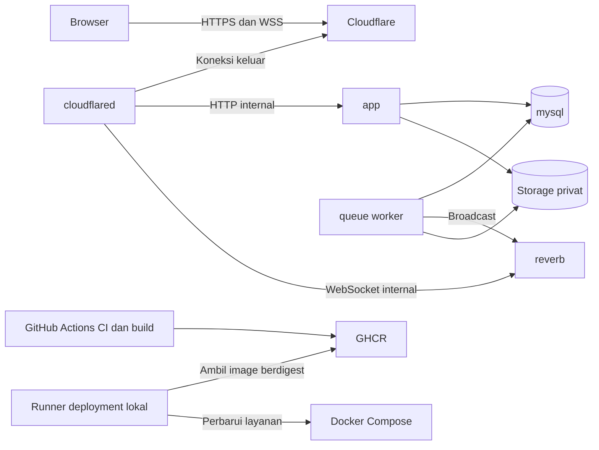

# Arsitektur deployment - SIA MI Alghivari

Diperbarui: 30 Oktober 2026. Status: blueprint demo yang disepakati; implementasi **NOT STARTED**, verifikasi runtime **NOT RUN**. Pemilik/operator: pemilik proyek. Acuan: [TECH_STACK.md](TECH_STACK.md).

## Target dan alternatif

Satu host lokal Windows menjalankan Docker Compose melalui Docker Desktop + WSL2 dengan Linux containers. Pemilik menyepakati runtime ini dan FrankenPHP classic berbasis Debian pada 29 Oktober 2026 (D-16); dukungan perangkat belum diperiksa. GitHub Actions membangun image, GHCR menyimpannya, dan runner lokal memperbarui demo. Cloudflare Tunnel menyediakan akses publik ke aplikasi/Reverb. Image untuk produksi berisi dependensi runtime dan aset terkompilasi; target saat ini tetap demo portofolio sintetis, bukan operasional sekolah.

Proses manual lebih ringan pada awal setup, tetapi Compose memenuhi kebutuhan menyalakan layanan bersama. VPS dapat dipilih kelak jika demo perlu tersedia tanpa komputer pribadi. Belum ada kebutuhan Kubernetes atau layanan terpisah per modul akademik.

## Topologi

Panah cloudflared ke Cloudflare menunjukkan pembentukan tunnel keluar; trafik browser diteruskan melalui tunnel tersebut. Runner mengelola deployment, bukan fitur akademik.

| Layanan | Tanggung jawab | Lingkungan |
| --- | --- | --- |
| app | FrankenPHP classic melayani Laravel/Inertia dan aset frontend | Dev dan demo; berbasis Debian/PHP 8.5, versi FrankenPHP/rilis Debian/patch/digest belum dikunci. |
| mysql | Domain, audit, inbox dan database queue | Instance/volume dev dan demo terpisah; engine mengikuti keputusan stack final. |
| queue | Job broadcast dan retry | Image aplikasi sama dengan app; satu worker awal. |
| reverb | WebSocket private channel | Image aplikasi sama; satu instance, tanpa Redis. |
| vite | Hot reload dan source pengembangan | Dev saja; tidak dipublikasikan pada demo. |
| cloudflared | Satu Tunnel memetakan hostname aplikasi dan WebSocket | Diperlukan pada demo publik; profil ini tidak perlu dinyalakan untuk dev/demo lokal tanpa akses publik. |

App, queue dan reverb memakai image aplikasi/digest yang sama, dengan proses berbeda. Hanya app menjalankan HTTP FrankenPHP; queue dan reverb menjalankan proses CLI masing-masing. Classic mode memakai siklus permintaan PHP biasa; Octane dan worker mode FrankenPHP tidak diaktifkan. Worker antrean notifikasi tetap ada pada layanan queue. Tidak menambah Nginx/PHP-FPM terpisah pada baseline ini.

Runner adalah layanan host terpisah pada akun/lingkungan khusus. Akses Docker memberi kemampuan luas pada host; jangan menjalankan kode PR atau workflow tak tepercaya pada runner ini. Isolasi Windows/WSL2 dan akses Docker Desktop dipastikan saat implementasi.

## Domain, TLS dan jaringan

D-33 dikonfirmasi pemilik 30 Oktober 2026. Contoh memakai placeholder `<nama>` yang harus diganti nama registrasi sebenarnya; domain belum dimiliki dan hostname belum aktif:

| Hostname | Tujuan internal ilustratif |
| --- | --- |
| `sia.<nama>.dpdns.org` | http://app:80; origin aplikasi pada network Compose privat, port ilustratif |
| `ws.<nama>.dpdns.org` | http://reverb:8080; origin WebSocket pada network Compose privat, port ilustratif |

Port/bind final mengikuti konfigurasi FrankenPHP classic yang kelak diuji. Document root hanya direktori public aplikasi. Rancangan origin memakai HTTP internal melalui network privat Compose di belakang Tunnel; konfigurasi TLS otomatis Caddy harus disesuaikan dengan topologi ini, dan port administrasi server tidak dipublikasikan. Dalam container cloudflared, gunakan nama service Compose; localhost menunjuk container itu sendiri. Satu tunnel dapat memetakan beberapa hostname ke service berbeda. [Cloudflare routing](https://developers.cloudflare.com/tunnel/concepts/routing/).

Koreksi fakta pemilik 30 Oktober 2026: domain belum dimiliki; kandidat registrasi memakai akhiran .dpdns.org dari DigitalPlat. Nama lengkap, ketersediaan registrasi, kontrol DNS/nameserver, penerimaan zone Cloudflare dan sertifikat belum diverifikasi. Gunakan hostname saudara tingkat pertama terhadap zone aktif; jangan menganggap sertifikat mencakup seluruh subdomain bertingkat. [Batas Universal SSL](https://developers.cloudflare.com/ssl/edge-certificates/universal-ssl/limitations/). Proyek lain pada domain yang sama tidak otomatis mendapat akses ke network/database SIA.

Browser memakai HTTPS/WSS pada edge. Origin HTTP/WebSocket dapat melalui network privat Compose. Laravel/worker mengirim broadcast ke reverb internal; Echo memakai hostname publik. Autentikasi private channel tetap melalui endpoint aplikasi dan sesi/policy server. Batasi allowed origins ke aplikasi, gunakan cookie secure yang dibatasi host, dan uji trusted proxy agar URL/cookie mengikuti HTTPS publik. Jangan cache rapor privat, halaman terautentikasi atau respons pribadi pada edge.

Tidak membuka database, Docker API, runner atau worker melalui tunnel. Tunnel keluar tidak memerlukan port forwarding router. Port lokal pengembangan, bila dibutuhkan, dibatasi loopback. Network Compose harus diverifikasi saat konfigurasi tersedia.

## Persistensi dan ketersediaan

Database dan storage privat memakai volume persisten. App/worker hanya mengakses storage yang diperlukan; source dev tidak dipasang ke demo. Pergantian image tidak mereset database/file. Volume bukan backup; salinan terpisah dan uji restore diperlukan. Dev/demo memakai Compose project, network, database, volume serta environment terpisah; profil saja tidak memberikan isolasi tersebut.

Healthcheck database dan dependensi siap digunakan mengatur startup. Restart policy menangani proses berhenti sesuai konfigurasi; status unhealthy saja tidak menjamin pemulihan otomatis. PC tidur/mati, internet putus atau Docker berhenti dapat membuat demo tidak tersedia. Belum ada klaim uptime, kapasitas, biaya atau zero downtime.

## Sebelum diaktifkan

Pastikan perangkat mendukung runtime, domain/TLS aktif, secret terpasang, data sintetis, backup dapat dipulihkan dan runner dibatasi. Verifikasi CI/CD, isolasi dev/demo, izin file, audit, WSS dan reconnect setelah pergantian versi. Semua masih **NOT RUN**. Detail: [rencana deployment](DEPLOYMENT_PLAN.md), [pipeline](CICD_PIPELINE_SPEC.md), [environment](ENVIRONMENT_SPEC.md).

## Host dan cadangan D-30

Fakta pemilik 30 Oktober 2026: satu komputer CPU generasi13 (model tepat belum diverifikasi), RAM24GB dan SSD2TB dengan ruang kosong100GB; tidak ada perangkat pengganti. Ini inventaris yang dilaporkan, bukan benchmark/validasi hardware. Alokasi awal6GB RAM/4CPU logis yang dibahas tetap usulan; dev/demo/build/restore berbagi resource sehingga disk/RAM aktual diperiksa sebelum operasi.

Backup terenkripsi dibuat lokal lalu pemilik unggah manual ke Google Drive, sesuai [DATA_RECOVERY_PLAN](DATA_RECOVERY_PLAN.md). File lokal saja tidak melindungi kehilangan host/SSD. Tidak ada integrasi Drive/sync otomatis atau waktu pemulihan hardware yang dijanjikan (D-32). Domain kandidat .dpdns.org tetap belum dimiliki; DNS/TLS/kapasitas/backup/restore seluruhnya NOT VERIFIED.

## D-33 — host demo, DNS dan TLS

Dikonfirmasi pemilik 30 Oktober 2026. Host demo memakai komputer pemilik Windows/CPU generasi13/RAM24GB/SSD kosong100GB dengan Docker Desktop+WSL2/Compose. Host dan model CPU dilaporkan, kompatibilitas serta kapasitas belum diuji; batas6GB/4CPU tetap usulan, bukan konfigurasi disetujui melalui D-33. Dev/demo terpisah, demo memakai image main dari hosted CI/GHCR berdigest melalui runner lokal tepercaya; bukan menjalankan source branch langsung.

Target domain registrasi adalah `<nama>.dpdns.org` DigitalPlat. Setelah registrasi berhasil, tambahkan domain tersebut sebagai zone Cloudflare dan atur NS yang diberikan pada pengelola domain. DNS authoritative dipilih Cloudflare; belum ada domain/zone/NS/certificate yang diaktifkan. Dukungan nameserver eksternal tersedia menurut [DigitalPlat](https://domain.digitalplat.org/), tetapi ketersediaan nama dan penerimaan zone milik pemilik tetap harus diverifikasi.

Satu Tunnel dengan dua route: `sia.<nama>.dpdns.org` ke app dan `ws.<nama>.dpdns.org` ke reverb. Jika zone yang benar-benar diterima adalah `<nama>.dpdns.org`, kedua hostname adalah saudara satu tingkat di bawah zone itu; cakupan Universal SSL tidak ditentukan dari jumlah titik terhadap dpdns.org global. Tunggu sertifikat valid untuk kedua host; jangan menganggap wildcard bertingkat tercakup. Jika registrasi/zone/cert ditolak, hentikan aktivasi dan tinjau opsi bersama pemilik, tidak mengganti/membeli domain diam-diam.

Browser -> Cloudflare memakai HTTPS/WSS dan sertifikat publik yang dikelola Cloudflare; Cloudflare -> cloudflared melalui Tunnel terenkripsi; cloudflared -> app/Reverb melalui HTTP/WS pada network Compose privat. Origin HTTP tidak dipublikasikan langsung dan tidak memerlukan sertifikat origin publik pada baseline ini. Jangan memakai pengecualian validasi sertifikat untuk menyamarkan origin HTTPS yang tidak sah. App menerima skema HTTPS melalui trusted proxy yang sesuai hop aktual dan diperiksa, tanpa loop redirect.

Cookie sesi Secure/host aplikasi, allowed origins Reverb dibatasi origin aplikasi; private-channel auth tetap pada aplikasi dengan sesi/policy pengguna. Tidak memperluas cookie ke seluruh domain hanya karena Echo terhubung ke hostname ws. Respons personal/audit/inbox/PDF privat tidak dicache publik. MySQL/Docker API/runner/worker/port administrasi tidak menjadi route Tunnel dan tidak ada port forwarding router.

Demo online saat host/Docker/internet/Tunnel/app aktif; mode sleep dinonaktifkan selama sesi demo yang diumumkan. Restart policy tidak menjamin bangun dari sleep, internet pulih atau layanan24/7. Tidak menambah host cadangan/VPS/staging permanen. Nama domain lengkap, port/config final dan langkah aktual ditetapkan saat implementasi/aktivasi diotorisasi; blueprint ini bukan izin registrasi, DNS change, provisioning atau deployment.

Sebelum publik: verifikasi delegasi NS/DNS kedua host, certificate hostname/expiry/chain dan redirect HTTPS, login/cookie/proxy, PDF berizin/penolakan asing, WSS/private channel/reconnect serta fallback inbox. Catat hasil nyata pada revisi target, bukan sekadar Tunnel Healthy/HTTP200. Semua ini NOT RUN/NOT VERIFIED; gate/GO rilis tetap belum diberikan.
